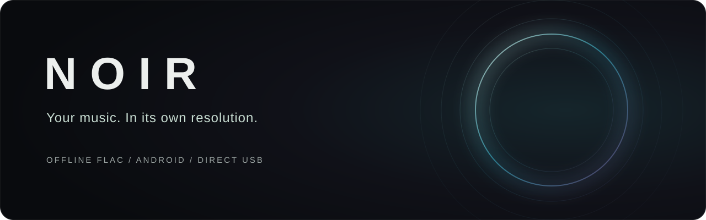
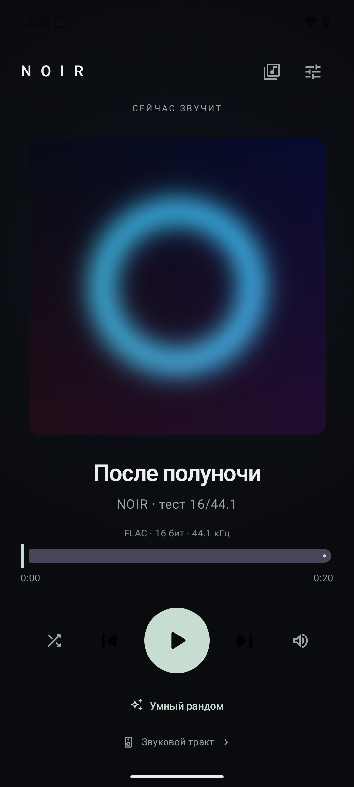

<p align="center">
  
</p>

<p align="center">
  <strong>Музыка с телефона. Тёмный интерфейс. Прямой USB.</strong><br />
  Минималистичный FLAC-плеер для тех, кто хочет выбрать папку и слушать.
</p>

<p align="center">
  
  
  <a href="LICENSE"></a>
</p>

<p align="center">
  <a href="https://github.com/YaMosly/NOIR-flac-audio-player/releases/tag/v0.7.0"><strong>Скачать APK</strong></a>
  &nbsp; · &nbsp;
  <a href="#быстрый-старт">Первый запуск</a>
  &nbsp; · &nbsp;
  <a href="#сборка-из-исходников">Собрать самому</a>
  &nbsp; · &nbsp;
  <a href="https://github.com/YaMosly/NOIR-flac-audio-player/issues">Сообщить о проблеме</a>
</p>

---

## Слушать без лишнего

NOIR воспроизводит локальные FLAC-файлы из выбранной папки. Крупная обложка,
мягкое свечение, основные кнопки и очередь — всё, что нужно для прослушивания.
Интерфейс сейчас на русском языке.

- **Локальная библиотека.** Доступ к выбранной папке через системный проводник Android.
- **Умный рандом.** Ранние пропуски постепенно снижают вероятность трека.
  Повторяющиеся пропуски учитываются и для исполнителя, но не исключают его навсегда.
  Можно включить обычное перемешивание или сбросить историю.
- **Два способа вывода.** Стандартный путь Android и экспериментальный прямой USB для совместимого ЦАПа.
- **Исходный формат FLAC.** В прямом USB-режиме — стерео PCM 16/24/32 бит
  с частотой исходного файла в пределах поддерживаемых профилей.
- **Фоновое воспроизведение.** Системные медиакнопки, управление с экрана блокировки и виджет.
- **Диагностика.** Формат трека, USB-устройство и сведения о текущем звуковом тракте.

Без аккаунта, рекламы и подписки. В приложении нет разрешения на доступ в интернет;
библиотека и история прослушивания хранятся на устройстве.

<p align="center">
  
</p>
<p align="center"><sub>Интерфейс плеера. На скриншоте — синтетический тестовый трек.</sub></p>

## Быстрый старт

1. Скачай `NOIR-0.7.0-preview.apk` из [Releases](https://github.com/YaMosly/NOIR-flac-audio-player/releases/tag/v0.7.0).
2. Открой APK на телефоне и разреши установку из выбранного источника, если Android попросит.
3. Запусти NOIR, выбери папку с FLAC-файлами и предоставь доступ к ней.
4. Включи музыку. Для обычного воспроизведения внешний ЦАП не обязателен.

Для прямого USB подключи совместимый ЦАП, открой **«Звуковой тракт»**, включи
**«Прямой USB в плеере»** и подтверди системный доступ к устройству.
Начинай с невысокой громкости: в этом режиме NOIR управляет аппаратной громкостью ЦАПа.

### Если музыка останавливается при выключении экрана

Открой **Настройки → Работа при выключенном экране** в NOIR и разреши работу
без оптимизации батареи. На vivo / OriginOS может отдельно потребоваться
разрешение фонового энергопотребления в настройках приложения на телефоне.
На тестовом vivo это устранило остановку музыки при погашенном экране.
Названия системных пунктов зависят от прошивки.

## Прямой USB и совместимость

**В 0.8.0 прямой USB выбирает совместимый путь по USB-дескрипторам, без списка брендов.
Это не обещание работы собственного транспорта с каждым ЦАПом: для остальных
устройств доступен стандартный вывод Android.**

Публичный релиз по ссылке выше — 0.7.0, подтверждённый владельцем на vivo / ddHiFi.
0.8.0 — новая тестовая сборка с изменениями ниже. Новые USB-режимы и расход батареи
на реальном устройстве ещё требуют проверки.

| | Поддержка в 0.8.0 |
| --- | --- |
| Android | 14 и новее, min API 34; compile/target API 37 (Android 17) |
| Архитектуры APK | `arm64-v8a`, `x86_64` |
| Музыка | Локальные FLAC-файлы; для прямого USB — стерео |
| Прямой USB | UAC2 Type I PCM, adaptive/synchronous OUT или async OUT с отдельным explicit feedback IN; full-speed и high-speed; простой путь Input Terminal → Feature Unit → Output Terminal |
| PCM в прямом режиме | 16 / 24 / 32 бит |
| Частоты в прямом режиме | 44.1 / 48 / 88.2 / 96 / 176.4 / 192 / 352.8 / 384 кГц |
| Основное физическое тестирование | vivo V2562, Android 16 / OriginOS 6, ddHiFi TC44C M2 |

Целочисленный FLAC-декодер и собственный USB-транспорт позволяют передавать PCM
мимо микшера Android, без программного эквалайзера, повышения частоты и снижения
разрядности в прямом пути. Более высокая частота сама по себе не улучшает запись:
NOIR следует формату файла.

**Bit-perfect всего тракта не измерен.** Успешная USB-передача, диагностический
хеш PCM или подтверждённая настройка частоты не являются измерением аналогового выхода.
В стандартном режиме окончательный формат вывода определяет Android.

### Что пока ограничено

- Implicit feedback, UAC1/UAC3, clock selector/multiplier, несколько неоднозначных путей, отсутствие доступного аппаратного регулятора громкости: используй стандартный вывод Android. Explicit feedback в 0.8.0 экспериментален и пока проверен на модели USB, не на физическом async-ЦАПе.
- Наличие подходящих дескрипторов ещё не подтверждает работу конкретной пары телефона/ЦАПа. Новые профили требуют физической проверки; работа 0.7.0 на комплекте vivo / ddHiFi подтверждена владельцем.
- При нескольких USB-аудиоустройствах прямой режим просит оставить одно. Не переключает музыку автоматически на другой выход; кнопка системного вывода ставит воспроизведение на паузу. После эксклюзивного USB некоторым прошивкам нужно переподключение ЦАПа.
- CUE-разметка, эквалайзер, редактирование тегов и интеграции со стримингами отсутствуют.
- Gapless прямого USB действует для соседних треков одинакового PCM-формата. При смене частоты/разрядности ЦАП перенастраивается и возможна пауза. Физический стык и расход батареи требуют проверки на телефоне.
- В диагностике остановки USB встречался случай неполной очистки очереди передач;
  обработка паузы и переключений ещё требует проверки на физическом устройстве.
- Preview APK подписан локальным отладочным ключом. Это тестовая сборка;
  самостоятельно собранный APK обычно имеет другую подпись и не установится поверх неё.
  Удаление приложения перед такой установкой удаляет его настройки и историю.

## Сборка из исходников

Понадобятся **JDK 21**, Android SDK Platform **37**, Build Tools **36.0.0**,
NDK **30.0.16248370** и CMake **4.1.2**. Версии Gradle и плагинов зафиксированы в проекте.

```bash
git clone https://github.com/YaMosly/NOIR-flac-audio-player.git
cd NOIR-flac-audio-player
```

Укажи расположение Android SDK через `ANDROID_HOME` либо локальный файл
`local.properties` с `sdk.dir`. Этот файл не публикуется.

**Windows / PowerShell:**

```powershell
.\gradlew.bat :app:assembleRelease :app:testDebugUnitTest :app:lintDebug
```

**Linux / macOS:**

```bash
./gradlew :app:assembleRelease :app:testDebugUnitTest :app:lintDebug
```

Готовый APK: `app/build/outputs/apk/release/app-release.apk`.
Текущая конфигурация `release` использует локальный debug-ключ и отключённый R8.
Для собственной публичной сборки настрой постоянный ключ подписи;
приватные ключи и пароли держи вне Git.

### Проверки

В проекте есть JVM-тесты метаданных FLAC, перемешивания и USB-протокола,
Android-тесты плеера и нативного транспорта, а также синтетические эталоны
для всех 24 сочетаний частоты и разрядности прямого режима.
Автоматические проверки с моделью USB не заменяют прослушивание с физическим ЦАПом.

Часть Android-тестов использует выделенный эмулятор `noir-api36` с синтетической
библиотекой и меняет его локальные настройки. Не запускай весь набор на личном телефоне.
Подготовка тестовой музыки:

```bash
python -m pip install numpy soundfile mutagen Pillow
python tools/create-fixtures.py
python tools/prepare-emulator-fixtures.py /path/to/adb emulator-5554
```

Перед подготовкой установи debug APK в указанный эмулятор.
После подготовки запускай `:app:connectedDebugAndroidTest` через Gradle wrapper.
Внутренняя документация разработки и локальные отчёты исключены через `.gitignore`;
сами тесты и скрипты остаются в репозитории.

## Обратная связь

Нашёл проблему? Создай [Issue](https://github.com/YaMosly/NOIR-flac-audio-player/issues)
и укажи версию NOIR, модель телефона, Android / прошивку, ЦАП, формат трека
и шаги воспроизведения. Для проблем со звуком приложи диагностику из приложения,
предварительно проверив её на личные данные.

## Лицензии и благодарности

Код NOIR распространяется под [MIT License](LICENSE).
Компоненты сторонних проектов сохраняют свои лицензии:

- **AndroidX Media3 / ExoPlayer** и FLAC renderer / JNI — Apache-2.0.
- **libFLAC 1.5.0** — BSD-лицензия библиотеки; полный vendored-архив также содержит
  компоненты под другими лицензиями. Командные утилиты libFLAC в APK не собираются.
- **Jetpack Compose** — интерфейс приложения.

Происхождение исходников декодера описано в
[VENDOR.md](app/src/main/cpp/flac/VENDOR.md), тексты лицензий — в
[уведомлениях приложения](app/src/main/assets/THIRD_PARTY_AUDIO_LICENSES.txt)
и соответствующих каталогах сторонних исходников.

<p align="center"><sub>NOIR · By Ulibaka</sub></p>

## Как выбирается USB-путь

В 0.8.0 номера AC/AS, alternate setting, OUT endpoint, Clock Source и Feature Unit
берутся из описания подключённого устройства. Clock и громкость должны принадлежать
выбранной цепи воспроизведения. Поддерживаются master volume или оба стереоканала.
Частота и тихий начальный уровень подтверждаются запросами GET после SET;
уровень округляется вниз по доступным шагам громкости. Исходные значения
восстанавливаются после подтверждения alt 0.

Допустимый пакет рассчитывается из фактической скорости USB и bInterval,
а не из предположения о 8000 интервалах/с. Для async UAC2 поддержан один явный feedback endpoint в том же alternate setting.
При потере обратной связи передача останавливается с ошибкой; implicit feedback
и сложные топологии остаются на системном выводе. Стандартный вывод Android остаётся способом
воспроизведения через устройства, поддерживаемые системой; его формат определяет
Android, обход микшера для него не заявляется.

Android 17: проект собирается с compileSdk/targetSdk 37. Для проверки запуска
используется эмулятор, а для USB и фонового воспроизведения необходим физический
телефон. Сведения о платформе: [настройка SDK](https://developer.android.com/about/versions/17/setup-sdk),
[изменения Android 17](https://developer.android.com/about/versions/17/behavior-changes-17),
[USB-аудио Android](https://source.android.com/docs/core/audio/usb).

## Что нового в тестовой 0.8.0

- **Очередь:** меню трека «Слушать следующим» / «В конец очереди», экран очереди
  с поиском, удалением и перемещением вверх/вниз. Ручные записи не заменяются
  умным рандомом. Явное изменение порядка закрепляет показанную будущую очередь;
  автоматические предложения дополняют её в конце. Сохраняются текущий трек,
  позиция и до 999 следующих записей, включая повторы; история Back после
  перезапуска не восстанавливается. Записи, отсутствующие в библиотеке или
  не поддерживаемые выбранным режимом, исключаются при восстановлении.
  Формат старых настроек продолжает читаться.
- **Поиск:** название, исполнитель, альбом; несколько слов могут находиться
  в разных тегах. Регистр и диакритика не мешают поиску.
- **Предпочтения:** «Реже этот трек» / «Реже этого исполнителя» с Undo и списком
  отмены в настройках. Ручной выбор хранится отдельно от статистики скипов и
  действует до отмены. Он снижает шанс, не исключая музыку. Обычный рандом
  остаётся равномерным; ручные предпочтения применяются в умном перемешивании.
- **Gapless:** одинаковые PCM rate/bits/channels продолжают одну USB-сессию
  и один счётчик PCM без вставки тишины, fade или пересоздания транспорта.
  Перемотка, смена вывода и несовместимый следующий формат требуют нового старта.
- **Нагрузка:** завершения USB находят свой слот по индексу, свободные слоты
  хранятся отдельно вместо постоянного сканирования очереди из 1024 элементов.
  Целевой интервал объединения пробуждений — 500 мкс; однопакетный workaround vivo
  и глубокая очередь сохранены. Опрос позиции UI и анимация останавливаются в фоне.
  Тест уменьшения wakeups — модель; измеренного процента экономии батареи нет.

### Explicit feedback

Используется отдельный isochronous feedback IN endpoint того же UAC2 alternate.
Поддержаны full-speed Q10.14/Q16.16 и high-speed Q16.16. Оценка частоты проверяется
в пределах ±1% от согласованной частоты, плавно обновляется; нулевые ответы
во время захвата clock не считаются новой частотой. Если корректного feedback
нет 500 мс или подряд получены три повреждённых значения, поток останавливается.
Пакет данных должен иметь запас ещё одного стереокадра. Меняется только
количество целых PCM-кадров в пакетах: ресемплинга, повторения или удаления
аудиосэмплов нет. Feedback URB живут вместе с native-сессией до закрытия fd,
включая нештатное завершение очистки.

Стандарты и API: [описание UAC2 streaming](https://learn.microsoft.com/en-us/windows-hardware/drivers/audio/usb-2-0-audio-drivers),
[реализация USB feedback в Linux](https://github.com/torvalds/linux/blob/master/sound/usb/endpoint.c).
Поддержка implicit feedback и других UAC-топологий отслеживается в issue #2.
