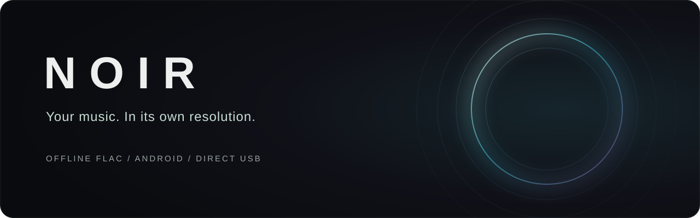
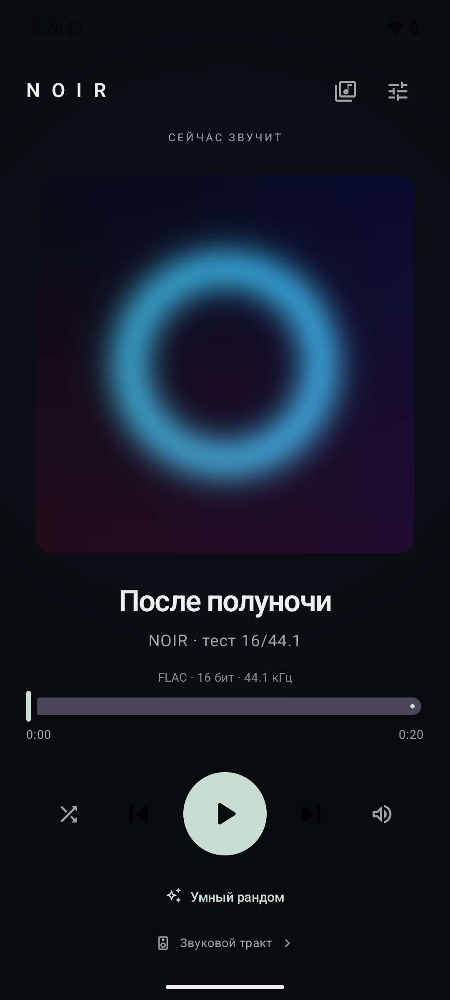

<p align="center">
  
</p>

<p align="center">
  <strong>Музыка с телефона. Тёмный интерфейс. Прямой USB.</strong><br />
  Минималистичный FLAC-плеер для тех, кто хочет выбрать папку и слушать.
</p>

<p align="center">
  
  
  <a href="LICENSE"></a>
</p>

<p align="center">
  <a href="https://github.com/YaMosly/NOIR-flac-audio-player/releases/tag/v0.6.2"><strong>Скачать APK</strong></a>
  &nbsp; · &nbsp;
  <a href="#быстрый-старт">Первый запуск</a>
  &nbsp; · &nbsp;
  <a href="#сборка-из-исходников">Собрать самому</a>
  &nbsp; · &nbsp;
  <a href="https://github.com/YaMosly/NOIR-flac-audio-player/issues">Сообщить о проблеме</a>
</p>

---

## Слушать без лишнего

NOIR воспроизводит локальные FLAC-файлы из выбранной папки. Крупная обложка,
мягкое свечение, основные кнопки и очередь — всё, что нужно для прослушивания.
Интерфейс сейчас на русском языке.

- **Локальная библиотека.** Доступ к выбранной папке через системный проводник Android.
- **Умный рандом.** Ранние пропуски постепенно снижают вероятность трека.
  Повторяющиеся пропуски учитываются и для исполнителя, но не исключают его навсегда.
  Можно включить обычное перемешивание или сбросить историю.
- **Два способа вывода.** Стандартный путь Android и экспериментальный прямой USB для совместимого ЦАПа.
- **Исходный формат FLAC.** В прямом USB-режиме — стерео PCM 16/24/32 бит
  с частотой исходного файла в пределах поддерживаемых профилей.
- **Фоновое воспроизведение.** Системные медиакнопки, управление с экрана блокировки и виджет.
- **Диагностика.** Формат трека, USB-устройство и сведения о текущем звуковом тракте.

Без аккаунта, рекламы и подписки. В приложении нет разрешения на доступ в интернет;
библиотека и история прослушивания хранятся на устройстве.

<p align="center">
  
</p>
<p align="center"><sub>Интерфейс плеера. На скриншоте — синтетический тестовый трек.</sub></p>

## Быстрый старт

1. Скачай `NOIR-0.6.2-preview.apk` из [Releases](https://github.com/YaMosly/NOIR-flac-audio-player/releases/tag/v0.6.2).
2. Открой APK на телефоне и разреши установку из выбранного источника, если Android попросит.
3. Запусти NOIR, выбери папку с FLAC-файлами и предоставь доступ к ней.
4. Включи музыку. Для обычного воспроизведения внешний ЦАП не обязателен.

Для прямого USB подключи совместимый ЦАП, открой **«Звуковой тракт»**, включи
**«Прямой USB в плеере»** и подтверди системный доступ к устройству.
Начинай с невысокой громкости: в этом режиме NOIR управляет аппаратной громкостью ЦАПа.

### Если музыка останавливается при выключении экрана

Открой **Настройки → Работа при выключенном экране** в NOIR и разреши работу
без оптимизации батареи. На vivo / OriginOS может отдельно потребоваться
разрешение фонового энергопотребления в настройках приложения на телефоне.
На тестовом vivo это устранило остановку музыки при погашенном экране.
Названия системных пунктов зависят от прошивки.

## Прямой USB и совместимость

**Это ранняя preview-версия. Прямой USB пока рассчитан на конкретное устройство,
а не на любой USB-ЦАП.**

| | Поддержка в 0.6.2 |
| --- | --- |
| Android | 14 и новее, API 34+ |
| Архитектуры APK | `arm64-v8a`, `x86_64` |
| Музыка | Локальные FLAC-файлы; для прямого USB — стерео |
| Прямой USB | ddHiFi TC44C M2, USB ID `0E55:1110`, с проверкой дескрипторов |
| PCM в прямом режиме | 16 / 24 / 32 бит |
| Частоты в прямом режиме | 44.1 / 48 / 88.2 / 96 / 176.4 / 192 / 352.8 / 384 кГц |
| Основное физическое тестирование | vivo V2562, Android 16 / OriginOS 6, ddHiFi TC44C M2 |

Целочисленный FLAC-декодер и собственный USB-транспорт позволяют передавать PCM
мимо микшера Android, без программного эквалайзера, повышения частоты и снижения
разрядности в прямом пути. Более высокая частота сама по себе не улучшает запись:
NOIR следует формату файла.

**Bit-perfect всего тракта не измерен.** Успешная USB-передача, диагностический
хеш PCM или подтверждённая настройка частоты не являются измерением аналогового выхода.
В стандартном режиме окончательный формат вывода определяет Android.

### Что пока ограничено

- Совместимость прямого USB с другими ЦАПами не реализована; для них используй стандартный вывод Android.
- CUE-разметка, эквалайзер, редактирование тегов и интеграции со стримингами отсутствуют.
- Бесшовность между треками, расход батареи и поведение на других прошивках требуют дальнейшей проверки.
- В диагностике остановки USB встречался случай неполной очистки очереди передач;
  обработка паузы и переключений ещё требует проверки на физическом устройстве.
- Preview APK подписан локальным отладочным ключом. Это тестовая сборка;
  самостоятельно собранный APK обычно имеет другую подпись и не установится поверх неё.
  Удаление приложения перед такой установкой удаляет его настройки и историю.

## Сборка из исходников

Понадобятся **JDK 21**, Android SDK Platform **36**, Build Tools **36.0.0**,
NDK **30.0.16248370** и CMake **4.1.2**. Версии Gradle и плагинов зафиксированы в проекте.

```bash
git clone https://github.com/YaMosly/NOIR-flac-audio-player.git
cd NOIR-flac-audio-player
```

Укажи расположение Android SDK через `ANDROID_HOME` либо локальный файл
`local.properties` с `sdk.dir`. Этот файл не публикуется.

**Windows / PowerShell:**

```powershell
.\gradlew.bat :app:assembleRelease :app:testDebugUnitTest :app:lintDebug
```

**Linux / macOS:**

```bash
./gradlew :app:assembleRelease :app:testDebugUnitTest :app:lintDebug
```

Готовый APK: `app/build/outputs/apk/release/app-release.apk`.
Текущая конфигурация `release` использует локальный debug-ключ и отключённый R8.
Для собственной публичной сборки настрой постоянный ключ подписи;
приватные ключи и пароли держи вне Git.

### Проверки

В проекте есть JVM-тесты метаданных FLAC, перемешивания и USB-протокола,
Android-тесты плеера и нативного транспорта, а также синтетические эталоны
для всех 24 сочетаний частоты и разрядности прямого режима.
Автоматические проверки с моделью USB не заменяют прослушивание с физическим ЦАПом.

Часть Android-тестов использует выделенный эмулятор `noir-api36` с синтетической
библиотекой и меняет его локальные настройки. Не запускай весь набор на личном телефоне.
Подготовка тестовой музыки:

```bash
python -m pip install numpy soundfile mutagen Pillow
python tools/create-fixtures.py
python tools/prepare-emulator-fixtures.py /path/to/adb emulator-5554
```

Перед подготовкой установи debug APK в указанный эмулятор.
После подготовки запускай `:app:connectedDebugAndroidTest` через Gradle wrapper.
Внутренняя документация разработки и локальные отчёты исключены через `.gitignore`;
сами тесты и скрипты остаются в репозитории.

## Обратная связь

Нашёл проблему? Создай [Issue](https://github.com/YaMosly/NOIR-flac-audio-player/issues)
и укажи версию NOIR, модель телефона, Android / прошивку, ЦАП, формат трека
и шаги воспроизведения. Для проблем со звуком приложи диагностику из приложения,
предварительно проверив её на личные данные.

## Лицензии и благодарности

Код NOIR распространяется под [MIT License](LICENSE).
Компоненты сторонних проектов сохраняют свои лицензии:

- **AndroidX Media3 / ExoPlayer** и FLAC renderer / JNI — Apache-2.0.
- **libFLAC 1.5.0** — BSD-лицензия библиотеки; полный vendored-архив также содержит
  компоненты под другими лицензиями. Командные утилиты libFLAC в APK не собираются.
- **Jetpack Compose** — интерфейс приложения.

Происхождение исходников декодера описано в
[VENDOR.md](app/src/main/cpp/flac/VENDOR.md), тексты лицензий — в
[уведомлениях приложения](app/src/main/assets/THIRD_PARTY_AUDIO_LICENSES.txt)
и соответствующих каталогах сторонних исходников.

<p align="center"><sub>NOIR · By Ulibaka</sub></p>
